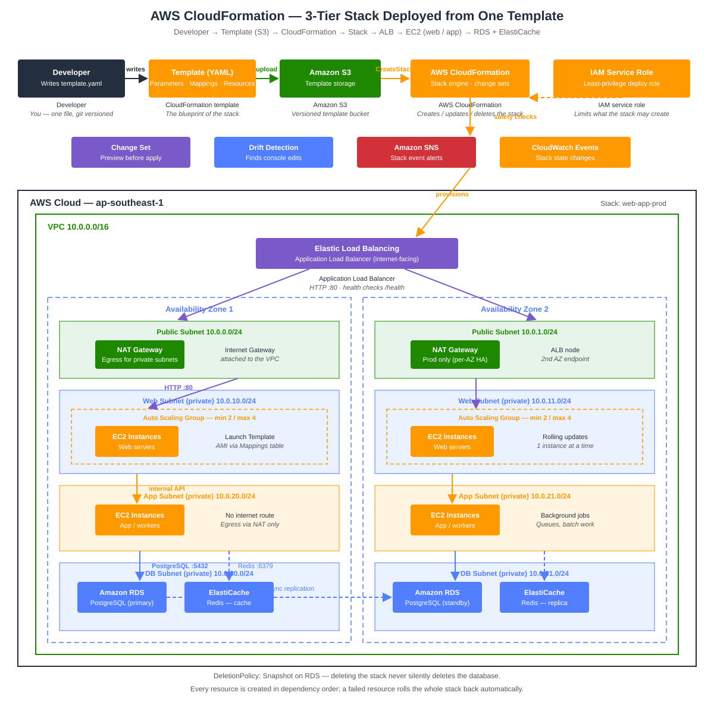

# AWS CloudFormation — Infrastructure as Code, the AWS-Native Way


> **TL;DR** — AWS CloudFormation turns your infrastructure into a text file. You describe the VPC, subnets, load balancer, EC2 instances, database and cache in a template, and CloudFormation creates, updates and deletes them as one unit called a **stack** — in the right order, with automatic rollback if anything fails. No more clicking through the console and forgetting what you built. This guide covers templates, stacks, parameters, change sets, drift detection, nested stacks, and the traps that turn a 5-minute deploy into a 2-hour rollback.

---

## 📐 Architecture



**Traffic flow:** Developer writes a template → template is stored in S3 → `CreateStack` / `UpdateStack` → CloudFormation (with an IAM service role) provisions resources in dependency order → VPC with public / web / app / db subnets across two Availability Zones → Application Load Balancer → EC2 Auto Scaling group → RDS (Multi-AZ) + ElastiCache. CloudWatch Events / EventBridge watches stack events, SNS notifies on failure, and drift detection reports any manual console edits.

---

## 🧩 The Pieces, in One Picture

| Piece | What it does | Think of it as |
|---|---|---|
| **Template** | A YAML/JSON file describing every resource, its properties, and how they connect | The blueprint of the house |
| **Stack** | One deployed instance of a template — all its resources managed as a single unit | The house built from the blueprint |
| **StackSet** | Deploys the same stack across many accounts and regions from one place | A housing estate built from one blueprint |
| **Change set** | A preview of exactly what an update will add, modify, or delete — before anything changes | The contractor's quote before work starts |
| **Drift detection** | Compares the real resources against the template and reports manual changes | The building inspector checking for unauthorised extensions |
| **Nested stack** | A stack created from inside another stack — splits a big template into modules | Rooms built by specialist teams, assembled into one house |
| **Parameters** | Inputs to a template (environment, instance type, CIDR) — same template, many deployments | The options you tick on the order form |
| **Mappings & Conditions** | Lookup tables (e.g. AMI per region) and if/else logic inside a template | The "if the plot is in Singapore, use this foundation" rules |
| **Outputs & Exports** | Values a stack publishes (VPC ID, ALB DNS name) for other stacks to import | The address plaque other builders can read |
| **Service role** | The IAM role CloudFormation assumes so it can create resources on your behalf | The foreman's badge — limits what the build crew may touch |
| **DeletionPolicy / UpdateReplacePolicy** | Controls what happens to a resource (keep, snapshot, or delete) when its stack is deleted or replaced | "Keep the safe when demolishing the house" |

---

## 🆚 CloudFormation vs Terraform vs ClickOps

| | CloudFormation | Terraform | Console clicking (ClickOps) |
|---|---|---|---|
| **State** | Managed by AWS — no state file to lose | State file you must store and lock (S3 + DynamoDB) | In your head (and nowhere else) |
| **Providers** | AWS only | Multi-cloud, 1000+ providers | AWS only |
| **Preview** | Change sets — exact diff before applying | `terraform plan` | None — you find out live |
| **Rollback** | Automatic on failure (unless disabled) | Manual — you fix it yourself | Manual, and good luck remembering |
| **Drift detection** | Built in | `terraform plan` / refresh | You notice when things break |
| **Module reuse** | Nested stacks, Registry modules | Modules, Registry | Copy-paste screenshots |
| **Best for** | AWS-only teams, Service Catalog, StackSets across accounts | Multi-cloud, or teams that already live in Terraform | Demos, one-off experiments — never production |

> 💡 **The honest answer:** if you are all-in on AWS, CloudFormation's managed state and automatic rollback are hard to beat. If you need more than AWS, Terraform wins. Both beat clicking — every time.

---

## 🔀 The Stack Lifecycle

```text
Template written (YAML) ──► Validate ──► CreateStack ──► CREATE_IN_PROGRESS
                                                              │
                                        Resources created in dependency order
                                                              │
                                              ┌───────────────┴───────────────┐
                                              ▼                               ▼
                                    CREATE_COMPLETE                     CREATE_FAILED
                                     (stack live)               (automatic ROLLBACK)
                                                              │
UpdateStack ──► Change set preview ──► Execute ──► UPDATE_IN_PROGRESS
                                              │
                                   ┌────────────┴────────────┐
                                   ▼                         ▼
                          UPDATE_COMPLETE          UPDATE_ROLLBACK_COMPLETE
DeleteStack ──► DELETE_IN_PROGRESS ──► DELETE_COMPLETE (or DELETE_FAILED — see traps)
```

**What a change set shows you:** every resource that will be added, modified, or **replaced** (replacement = delete + recreate — your data may go with it). Always review the change set before executing. Always.

```bash
# Validate the template syntax (free, no stack created)
aws cloudformation validate-template --template-body file://cloudformation_demo.yaml

# Preview the change — the single most valuable command in this guide
aws cloudformation create-change-set \
  --stack-name web-app-prod \
  --template-body file://cloudformation_demo.yaml \
  --change-set-name preview-01 \
  --capabilities CAPABILITY_NAMED_IAM

aws cloudformation describe-change-set \
  --stack-name web-app-prod --change-set-name preview-01 \
  --query 'Changes[*].{Action:ResourceChange.Action, LogicalId:ResourceChange.LogicalResourceId, Replacement:ResourceChange.Replacement}'

# Only when the preview looks right:
aws cloudformation execute-change-set \
  --stack-name web-app-prod --change-set-name preview-01
```

---

## 🛡️ Safety Rules — Read Before You Deploy

1. **Always use a change set for updates.** `UpdateStack` directly is like merging without reading the diff.
2. **Set a stack policy** to block updates to critical resources (e.g. the production database) — a policy can deny replacement of the RDS instance even if the template asks for it.
3. **Use `DeletionPolicy: Retain` (or `Snapshot`) on stateful resources** — RDS, S3 buckets with data, EBS volumes. Deleting a stack should never silently delete your data.
4. **Never hand-edit a resource that CloudFormation manages.** The next update or drift detection will fight you — and drift is how stacks get stuck.
5. **Give CloudFormation a least-privilege service role.** Without one it uses your credentials; with a scoped role, a bad template can only damage what the role allows.
6. **Disable rollback only while debugging** (`--disable-rollback`). In production, automatic rollback is the feature that saves you at 2 a.m.
7. **Mind the 500-resource limit per stack.** Past that, split into nested stacks — one per tier (network, app, data).
8. **Outputs are global per region.** An exported name must be unique in the region — use the stack name as a prefix to avoid collisions.

```yaml
# The three lines that save your database:
  AppDatabase:
    Type: AWS::RDS::DBInstance
    DeletionPolicy: Snapshot        # keep a final snapshot on delete/replace
    UpdateReplacePolicy: Snapshot   # snapshot first, even on replacement
    Properties:
      Engine: postgres
      DBInstanceClass: db.t3.micro
      AllocatedStorage: "20"
      MultiAZ: true
```

---

## 💰 Cost — What CloudFormation Itself Charges

CloudFormation is **free** — you pay only for the resources it creates. The real cost traps are in the template, not the service:

| Trap | What happens | Fix |
|---|---|---|
| NAT Gateway per AZ, forgotten | ~$32/month per gateway, 24/7 | One shared NAT for dev; per-AZ NAT only for prod HA |
| `t3.micro` vs `t3.large` typo in a parameter default | 4x the compute bill, silently | Parameter constraints (`AllowedValues`) + change-set review |
| Orphaned resources after a failed delete | You pay for resources no stack owns | `DeletionPolicy` audit + `aws cloudformation list-stack-resources` |
| Stack stuck in `DELETE_FAILED` | Resources keep billing while you debug | Fix the blocking resource (often an S3 bucket that isn't empty), then retry delete |

---

## 💻 Quick Start — Deploy the Demo Template

[`cloudformation_demo.yaml`](cloudformation_demo.yaml) deploys a complete 3-tier stack: VPC (2 AZs, public/web/app/db subnets), Application Load Balancer, Auto Scaling group, RDS PostgreSQL Multi-AZ, and ElastiCache Redis — all from one file.

```bash
# 1. Validate first — catches syntax errors before AWS sees them
aws cloudformation validate-template --template-body file://cloudformation_demo.yaml

# 2. Preview the change set (do not skip this)
aws cloudformation create-change-set --stack-name cfn-demo \
  --template-body file://cloudformation_demo.yaml \
  --change-set-name preview-01 --capabilities CAPABILITY_NAMED_IAM

# 3. Deploy and watch events live
aws cloudformation create-stack --stack-name cfn-demo \
  --template-body file://cloudformation_demo.yaml \
  --capabilities CAPABILITY_NAMED_IAM \
  --parameters ParameterKey=Environment,ParameterValue=dev

aws cloudformation wait stack-create-complete --stack-name cfn-demo
aws cloudformation describe-stacks --stack-name cfn-demo \
  --query 'Stacks[0].Outputs'

# 4. Detect drift — did anyone touch the resources in the console?
aws cloudformation detect-stack-drift --stack-name cfn-demo
aws cloudformation describe-stack-resource-drifts --stack-name cfn-demo \
  --query 'StackResourceDrifts[*].{Resource:LogicalResourceId, Drift:StackResourceDriftStatus}'

# 5. Clean up (database is snapshotted, not deleted, thanks to DeletionPolicy)
aws cloudformation delete-stack --stack-name cfn-demo
```

---

## 🧠 Common Traps

- **Replacing a resource by accident** — changing an immutable property (e.g. an RDS engine version, or a subnet CIDR) triggers *replacement*, not an in-place update. The change set tells you: `Replacement: True`. Read it.
- **Circular dependencies** — resource A references B, B references A. CloudFormation refuses to deploy. Break the cycle with a parameter or a separate stack.
- **Hard-coded AMIs** — an AMI ID from `us-east-1` doesn't exist in `ap-southeast-1`. Use a `Mappings` table (or SSM parameter `/aws/service/ami-amazon-linux-latest/...`) instead.
- **Export name collisions** — two stacks exporting `VpcId` in one region. Prefix exports with the stack name.
- **Updating a stack someone else is updating** — concurrent updates fail with `ValidationError`. One writer at a time; use a CI pipeline as the single writer.
- **Forgetting `CAPABILITY_NAMED_IAM`** — any template creating IAM resources needs the capability flag, or the deploy fails with a confusing permissions error.
- **Stack stuck in `UPDATE_ROLLBACK_FAILED`** — usually a resource that can't be deleted (non-empty S3 bucket, ENI in use). Fix the resource, then `continue-update-rollback`.

---

## 📝 Quiz

Think you know it? Five questions in [`quiz.md`](quiz.md) — including the classic "my update deleted the database" puzzle.

---

## 📚 Further Reading

- [AWS CloudFormation User Guide](https://docs.aws.amazon.com/AWSCloudFormation/latest/UserGuide/)
- [Change sets](https://docs.aws.amazon.com/AWSCloudFormation/latest/UserGuide/using-cfn-updating-stacks-changesets.html)
- [Drift detection](https://docs.aws.amazon.com/AWSCloudFormation/latest/UserGuide/using-cfn-stack-drift.html)
- [Nested stacks](https://docs.aws.amazon.com/AWSCloudFormation/latest/UserGuide/using-cfn-nested-stacks.html)
- [Stack policies](https://docs.aws.amazon.com/AWSCloudFormation/latest/UserGuide/protect-stack-resources.html)
